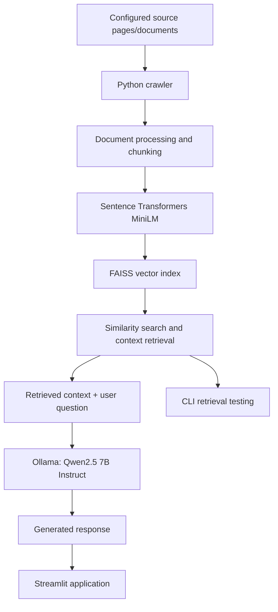

# Vinmec RAG — Document Question Answering System

> **Project type:** Personal project  
> **Year:** 2026  
> **Author:** Võ Thái Học  
> **GitHub:** [@VoThaiHocVN2005](https://github.com/VoThaiHocVN2005)

Vinmec RAG is an independent document question-answering project that demonstrates a Retrieval-Augmented Generation (RAG) workflow. It processes a collection of source documents, splits the content into chunks, generates embeddings, retrieves relevant context through FAISS vector search, and uses a locally running large language model (LLM) to generate responses.

The indexed collection used for this project contains **16,097 chunks**. The project provides a **Streamlit web interface** and a **command-line interface (CLI)** for querying, testing, and evaluating the retrieval workflow.

> **Disclaimer:** This is an independent personal project for learning and demonstration. It is not developed, endorsed, or maintained by Vinmec and is not an official Vinmec product or service. It is not a medical device and must not be used for diagnosis, treatment decisions, or as a substitute for professional medical advice. Verify important information against reliable original sources.

## Table of Contents

- [Project Overview](#project-overview)
- [Key Features](#key-features)
- [RAG Workflow](#rag-workflow)
- [Technology Stack](#technology-stack)
- [Project Structure](#project-structure)
- [Requirements](#requirements)
- [Installation](#installation)
- [Ollama and Local LLM Setup](#ollama-and-local-llm-setup)
- [Run the Project for the First Time](#run-the-project-for-the-first-time)
- [Run the Project Again](#run-the-project-again)
- [Available Run Modes](#available-run-modes)
- [Data, Privacy, and Responsible Use](#data-privacy-and-responsible-use)
- [Troubleshooting](#troubleshooting)
- [Project Information](#project-information)

## Project Overview

The project implements the main stages of a RAG pipeline:

1. Collect source content using the project crawler.
2. Split the collected content into smaller text chunks.
3. Generate vector embeddings with Sentence Transformers (MiniLM).
4. Build and store a searchable vector index using FAISS.
5. Retrieve relevant chunks for a user's question through vector similarity search.
6. Use the retrieved context with a locally hosted Qwen2.5 model through Ollama to generate an answer in the application workflow.

The project includes two ways to interact with the system:

- **Streamlit:** A web interface for interactive use of the application.
- **CLI:** A command-line workflow for testing retrieval and querying the indexed content. The `rag_cli.py` command described in this README is used to test the FAISS and embedding retrieval flow; it does **not** require Ollama or Streamlit.

## Key Features

- Crawl source content using the project's Python crawler.
- Split documents into chunks for retrieval.
- Generate text embeddings using Sentence Transformers (MiniLM).
- Build a FAISS vector index for similarity search.
- Retrieve relevant context for a user query.
- Integrate a locally hosted Qwen2.5:7B Instruct model through Ollama in the application workflow.
- Provide an interactive Streamlit web interface.
- Provide a CLI mode for retrieval experiments and testing.
- Include a separate embedding test script.
- Index **16,097 chunks** in the project dataset used for the 2026 project version.

The indexed chunk count describes the dataset used when the project was documented. It may change if the source content, crawler output, chunking configuration, or indexing process changes.

## RAG Workflow



The CLI retrieval test can be used to inspect the FAISS/embedding retrieval workflow without invoking Ollama. The Streamlit application is the interactive application entry point and uses the local LLM configuration described below.

## Technology Stack

| Area | Technologies |
|---|---|
| Programming language | Python 3.11 |
| Document collection | Requests, Beautiful Soup, lxml |
| RAG framework and processing | LangChain, LangChain Community, LangChain Text Splitters |
| Embeddings | Sentence Transformers, MiniLM |
| Vector database / search | FAISS (`faiss-cpu`) |
| Local LLM runtime | Ollama |
| Language model | Qwen2.5:7B Instruct, `qwen2.5:7b-instruct-q4_K_M` model tag |
| Web interface | Streamlit |
| Supporting libraries | Hugging Face Hub, Transformers, Tokenizers, python-dotenv, psutil |
| Interfaces | Streamlit web application and CLI |

## Project Structure

The following paths are referenced by the project's run commands. Other files and generated-data directories may also be present in the actual repository.

```text
vinmec-rag-document-qa/
├── README.md
├── requirements.txt
├── scripts/
│   ├── crawl_vinmec_all.py
│   ├── build_index.py
│   └── rag_cli.py
├── web/
│   └── app.py
└── test_embed.py
```

- `scripts/crawl_vinmec_all.py` — collects the source content configured for the project.
- `scripts/build_index.py` — processes the collected content, generates embeddings, and builds the FAISS index.
- `scripts/rag_cli.py` — runs the command-line retrieval test described in this README.
- `test_embed.py` — tests the embedding model.
- `web/app.py` — Streamlit application entry point.
- `requirements.txt` — Python dependencies for the project.

The exact location and names of generated documents, caches, and FAISS index files are determined by the implementation in the source code.

## Requirements

The setup instructions below are for **Windows** and use **Command Prompt (CMD)** syntax.

- Windows 10 or Windows 11.
- Python 3.11 and the Python Launcher (`py`).
- Git, to clone the repository (or download the repository as a ZIP file).
- Ollama for running the local LLM used by the Streamlit application.
- Sufficient local storage for the model, downloaded source content, embeddings, and FAISS index.
- An Internet connection for installing Python packages, downloading the Ollama model, and collecting the configured source content.

Check the Python version:

```bat
py -3.11 --version
```

## Installation

### 1. Clone the repository

```bash
git clone https://github.com/VoThaiHocVN2005/vinmec-rag-document-qa.git
cd vinmec-rag-document-qa
```

Alternatively, download the repository ZIP from GitHub and extract it. Open a terminal in the directory containing `requirements.txt`, `scripts`, `web`, and `test_embed.py`.

### 2. Create and activate a Python virtual environment

```bat
py -3.11 -m venv venv
venv\Scripts\activate
```

After activation, the terminal prompt should indicate that the `venv` environment is active.

If you use **PowerShell** instead of Command Prompt, activate the environment with:

```powershell
.\venv\Scripts\Activate.ps1
```

### 3. Upgrade pip

```bash
python -m pip install --upgrade pip
```

### 4. Install project dependencies

**Recommended: install from `requirements.txt`.**

```bash
pip install -r requirements.txt
```

Use the manual installation commands below only if you are setting up the environment without using `requirements.txt`. You normally do not need to run both installation methods.

### Alternative: install the dependencies manually

```bash
pip install requests beautifulsoup4 lxml
pip install langchain
pip install langchain-community
pip install langchain-text-splitters
pip install faiss-cpu
pip install huggingface_hub==0.20.3
pip install tokenizers==0.15.2
pip install transformers==4.36.2
pip install sentence-transformers==2.2.2
pip install streamlit
pip install python-dotenv
pip install psutil
```

## Ollama and Local LLM Setup

The application is configured to use the following Ollama model tag:

```text
qwen2.5:7b-instruct-q4_K_M
```

This is a Qwen2.5 7B Instruct model variant using the Q4_K_M quantization tag. Use the exact tag expected by the project configuration.

### 1. Install Ollama

Download and install Ollama for Windows from:

[https://ollama.com/download](https://ollama.com/download)

### 2. Verify the installation

Open Command Prompt and run:

```bat
ollama --version
```

### 3. Download the model

```bat
ollama pull qwen2.5:7b-instruct-q4_K_M
```

### 4. Confirm that the model is available

```bat
ollama list
```

Check that `qwen2.5:7b-instruct-q4_K_M` appears in the model list.

### 5. Optional: test the model directly

```bat
ollama run qwen2.5:7b-instruct-q4_K_M
```

Enter a test prompt, for example:

```text
Xin chào
```

When finished, exit the interactive session with `Ctrl + C`.

Make sure the Ollama service is running when you use the Streamlit workflow that calls the local model.

## Run the Project for the First Time

Complete the installation and Ollama setup above before following these steps.

Open Command Prompt in the project root directory and activate the virtual environment:

```bat
venv\Scripts\activate
```

### Step 1. Collect the source content

Run the crawler:

```bat
python scripts\crawl_vinmec_all.py
```

This step collects the source content configured in the crawler. Its output is used by the indexing script in the next step.

### Step 2. Build the FAISS index

```bat
python scripts\build_index.py
```

This step processes the collected content, splits it into chunks, generates embeddings, and builds the FAISS index used for retrieval.

The documented project dataset contains **16,097 indexed chunks**. The actual number produced may vary depending on the content collected and the project's processing configuration.

### Step 3. Test RAG retrieval through the CLI

```bat
python scripts\rag_cli.py
```

This CLI test exercises the FAISS and embedding retrieval flow. According to the current project run configuration, this command does **not** use Ollama and does **not** launch Streamlit.

### Step 4. Test the embedding model

```bat
python test_embed.py
```

### Step 5. Run the Streamlit web application

Make sure Ollama is installed, the configured Qwen2.5 model has been downloaded, and the Ollama service is running. Then execute:

```bat
streamlit run web/app.py
```

Streamlit will display the local address for the web application in the terminal. Open that address in your browser.

## Run the Project Again

After the initial data collection and index creation, you normally do not need to crawl the source content or rebuild the FAISS index every time you start the application.

1. Open Command Prompt in the project root directory.
2. Activate the existing virtual environment:

   ```bat
   venv\Scripts\activate
   ```

3. Make sure the Ollama service is running and the configured model is available.
4. Start the Streamlit application:

   ```bat
   streamlit run web/app.py
   ```

Re-run the crawler and index-building script when you intentionally need to refresh the source collection or rebuild the index. Follow the implementation's behavior and back up any data you need before replacing generated files.

## Available Run Modes

| Mode | Command | Purpose | Uses Ollama? |
|---|---|---|---|
| Data collection | `python scripts\crawl_vinmec_all.py` | Collect configured source content | No |
| Index building | `python scripts\build_index.py` | Chunk documents, generate embeddings, and build FAISS index | No, based on the documented setup |
| CLI retrieval test | `python scripts\rag_cli.py` | Test FAISS and embedding-based retrieval | No |
| Embedding test | `python test_embed.py` | Test the embedding model | No, based on the documented setup |
| Streamlit application | `streamlit run web/app.py` | Run the interactive RAG application | Yes, for the local LLM workflow |

## Data, Privacy, and Responsible Use

- Only collect and use source content that you are permitted to access and process. Respect the source website's terms, applicable laws, and crawler access rules.
- Do not upload confidential documents, private records, patient information, personal data, or other sensitive content to this repository or to a public demonstration.
- Do not represent this project as an official Vinmec system or claim that it is affiliated with Vinmec.
- RAG output may be incomplete, outdated, or incorrect. Retrieval of a document does not guarantee that a generated answer is accurate.
- Do not use this project to diagnose a condition, recommend treatment, or make healthcare decisions. Consult qualified healthcare professionals and verify information against original, authoritative sources.
- If you publish the repository, review the crawler output, downloaded data, generated index, logs, and Git history to ensure that no restricted or personal information is included.
- Do not commit local virtual environments, machine-specific paths, credentials, or unnecessary generated files.

## Troubleshooting

### `py -3.11` is not recognized

Install Python 3.11 and ensure the Python Launcher is available. Then reopen Command Prompt and check:

```bat
py -3.11 --version
```

### The virtual environment cannot be activated

Make sure the terminal is open in the project root and that the environment was created successfully:

```bat
py -3.11 -m venv venv
venv\Scripts\activate
```

For PowerShell, use `.\venv\Scripts\Activate.ps1` as shown in the installation section.

### A Python package cannot be imported

Confirm that the virtual environment is active, then install the dependencies:

```bat
python -m pip install --upgrade pip
pip install -r requirements.txt
```

If the issue continues, check the Python version and package versions recorded in `requirements.txt`.

### The FAISS index or source data cannot be found

Run the first-time setup steps in order:

```bat
python scripts\crawl_vinmec_all.py
python scripts\build_index.py
```

Run these commands from the project root. Check the script output for the actual input/output paths and any errors.

### Ollama cannot find the model

Check the installed model list:

```bat
ollama list
```

If the configured model is missing, download it again:

```bat
ollama pull qwen2.5:7b-instruct-q4_K_M
```

Make sure the model tag used by the application matches the installed tag exactly.

### The Streamlit application cannot connect to Ollama

- Confirm that Ollama is installed and its service is running.
- Confirm that `qwen2.5:7b-instruct-q4_K_M` is available in `ollama list`.
- Test the model directly with `ollama run qwen2.5:7b-instruct-q4_K_M`.
- Review the terminal output from Streamlit and Ollama for the underlying error.

### Streamlit command is not recognized

Activate the virtual environment and install the requirements:

```bat
venv\Scripts\activate
pip install -r requirements.txt
```

Then run:

```bat
python -m streamlit run web/app.py
```

## Project Information

- **Project name:** Vinmec RAG — Document Question Answering System
- **Project type:** Personal project
- **Year:** 2026
- **Indexed collection:** 16,097 chunks in the documented project dataset
- **Programming language:** Python
- **Embedding model family:** Sentence Transformers (MiniLM)
- **Vector search:** FAISS
- **Local LLM runtime:** Ollama
- **LLM:** Qwen2.5:7B Instruct (`qwen2.5:7b-instruct-q4_K_M`)
- **User interfaces:** Streamlit and CLI

## Author

**Võ Thái Học**  
GitHub: [github.com/VoThaiHocVN2005](https://github.com/VoThaiHocVN2005)